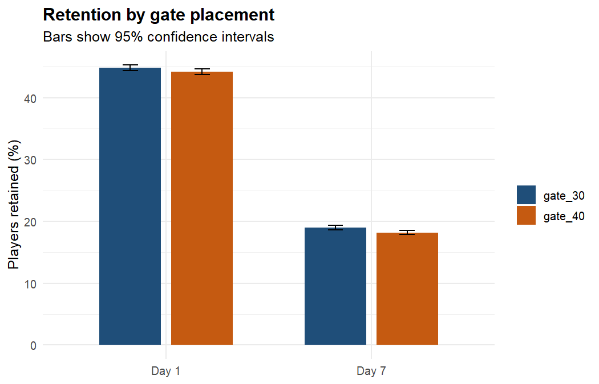
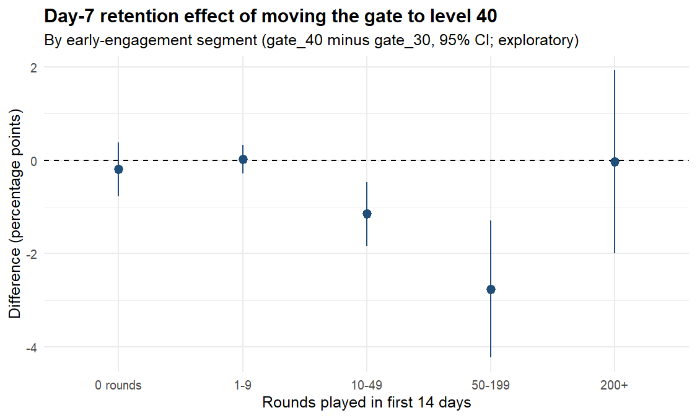

# Player Churn & Retention Analysis in R (Cookie Cats)

An end-to-end player-retention analysis in **R**: data validation, retention funnel, A/B test with
multiple-comparison correction, engagement segmentation, and a cross-validated churn model, including a check
for target leakage.

**Business question.** *Cookie Cats* is a mobile puzzle game. Progression "gates" make players wait or pay to continue.
The studio tested moving the first gate from **level 30** (`gate_30`, control) to **level 40** (`gate_40`).
Did the change improve retention, who churns, and can at-risk players be flagged early?

## Data
[Mobile Games A/B Testing: Cookie Cats](https://www.kaggle.com/datasets/yufengsui/mobile-games-ab-testing) (public; Tactile Entertainment).
90,189 players, one row each: `userid`, `version`, `sum_gamerounds` (rounds in the first 14 days),
`retention_1`, `retention_7` (returned on day 1 / day 7).
Churn is defined as **not returning on day 7** (a proxy; the data has no later activity).
The raw file is not committed; the script downloads a public mirror if `data/cookie_cats.csv` is missing.

## Results

| Finding | Result |
|---|---|
| Overall funnel | 44.5% return on day 1, 18.6% on day 7 (81.4% churn by day 7) |
| Day-7 retention, `gate_30` vs `gate_40` | 19.02% vs 18.20%, **-0.82 pp** (95% CI -1.33 to -0.31), p = 0.0016 (Holm-adjusted 0.0032) |
| Day-1 retention | -0.59 pp (95% CI -1.24 to +0.06), p = 0.076: not significant |
| Bootstrap | 99.9% probability that `gate_30` has the higher day-7 retention |
| Power | At 44,700 players per arm the test could detect a 0.74 pp day-7 effect at 80% power, so the observed 0.82 pp is above the detectable threshold |
| Where the damage is | Effect concentrated in mid-engagement players: 10-49 rounds **-1.15 pp** (Holm p = 0.003) and 50-199 rounds **-2.76 pp** (Holm p = 0.001). No detectable effect at 0-9 or 200+ rounds |
| Engagement drives retention | Day-7 retention by rounds played: 0.7% (0 rounds), 1.8% (1-9), 10.9% (10-49), 45.6% (50-199), 84.9% (200+) |
| Lifecycle | 51.5% never returned after install; 29.9% came back on day 1 only; 14.6% retained on both days |
| Early-warning rule | 92.8% of players who miss day 1 also miss day 7, versus 67.2% of day-1 returners. Flagging day-1 non-returners catches 63.3% of all day-7 churners while flagging 55.5% of players |
| Churn model (5-fold CV AUC) | Model A (day-1 return + version): **0.712**. Model B (+14-day rounds): 0.889, but inflated by leakage (see below) |

**Recommendation:** keep the first gate at level 30. Moving it to level 40 reduced day-7 retention, mainly among
players in the middle of the engagement range. Focus re-engagement effort (push notifications, day-1 rewards) on
players who do not return on day 1.




## Methods
1. **Validation:** duplicates, missing values, impossible values, outliers (one player logged 49,854 rounds in 14 days), sample-ratio-mismatch test.
2. **A/B test:** two-proportion tests with confidence intervals, Holm correction across metrics, bootstrap, power / minimum detectable effect.
3. **Segmentation:** five rule-based engagement tiers plus a four-stage lifecycle view built from the retention flags.
4. **Churn modelling:** logistic regression with 5-fold cross-validated AUC and odds ratios; a simple day-1 flag rule evaluated by precision and recall.

## Caveats (read these)
- **Sample-ratio mismatch:** the split is 44,700 vs 45,489, and a chi-square test gives p = 0.0086. This is a small imbalance but statistically detectable, and in a live experiment it would prompt an assignment-pipeline check before trusting results.
- **Segments are exploratory.** `sum_gamerounds` is measured *after* randomisation, so the gate itself can change how many rounds a player logs. Segment-level effects are hypotheses, not causal estimates.
- **Target leakage in Model B.** Rounds cover 14 days, which includes days 8-14, so they partly encode whether a player was still active. The AUC jump from 0.71 to 0.89 shows how a naive model would overstate its usefulness. Model A uses only information available by day 1.
- **Churn is a proxy.** "Not returning on day 7" is not the same as never returning.
- **No revenue or time-of-day data,** so RFM-style value segmentation is not possible with this dataset.

## Run it
```r
# R >= 4.3, packages: dplyr, readr, tidyr, ggplot2, pROC
Rscript R/churn_analysis.R
```
Outputs: `results/*.csv` and `figures/*.png`.

## Structure
```
R/churn_analysis.R   full pipeline (seeded, reproducible)
results/             all result tables (CSV)
figures/             charts (PNG)
data/                place cookie_cats.csv here (git-ignored)
```
